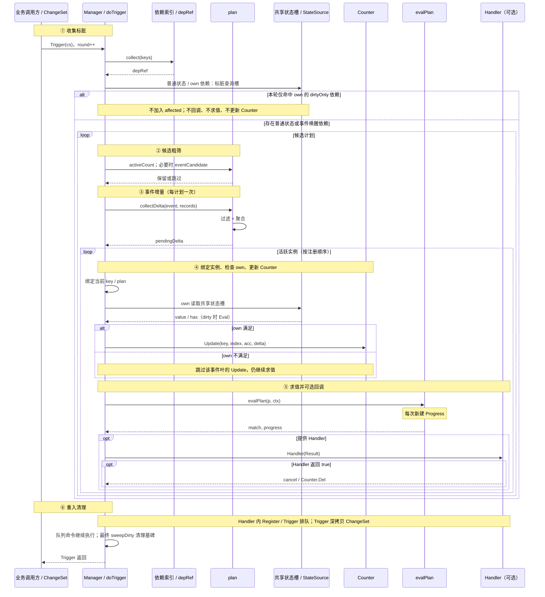

灵活表达游戏中任务条件需求，要求高效，单次触发检查在微秒级别。
实现语言为 golang，非必要对外暴露的函数和类型，不要对外暴露。

# 核心设计思想

- **状态与事件分离**：状态表示当前结果，事件表示已经发生的一次增量事实。状态型叶子在缓存标脏后读取玩家最新数据并复用本轮结果，事件型叶子读取本次事件数据并累计，不能用玩家当前值代替事件增量。
- **业务模型与框架分离**：框架只识别状态叶、事件叶、属性、过滤和聚合，不识别物品等具体业务结构；`stateLeaf` 的名称与数据源由接入系统定义。
- **索引与求值分离**：依赖索引只负责快速排除不可能命中的条件，允许多选但不能漏选；最终是否命中仍由实时过滤和表达式求值决定。
- **事件分阶段处理**：按“事件 id 与过滤属性粗筛 → 读取事件数据并实时过滤 → 检查 own 前置状态 → 更新事件计数 → 求值表达式”的顺序处理。
- **统一逻辑表达**：外层表达式、状态表达式和过滤器使用一致的 `!、&、|` 及括号规则，但分别在条件叶、状态叶和单条记录层级求值。

# 当前运行期实现

### 对象职责

| 对象 | 当前职责 |
| --- | --- |
| `Expr` | `Parse` 产出的不可变表达式，同时保存语法树、签名和编译好的 `program`，可跨 `Manager` 复用。 |
| `Plans` | 配置加载期建立“表达式签名 → 编译产物”的只读计划表，供多个 `Manager` 共享；同一份计划表只接受同一套 `ParseConfig`。 |
| `Manager` | 服务一个 owner，保存注册实例、计划本地绑定、共享状态槽、依赖索引和命令队列；不是并发安全类型。 |
| `StateSource` | 由业务实现，按 `Query` 读取玩家常驻状态；事件记录不经过该接口。 |
| `Counter` | 由业务实现，按实例键和外部叶编号保存事件累计状态，可使用内存、Redis 或数据库。 |
| `ChangeSet` | 描述一次业务变化，可携带一批状态依赖 Key，并可同时携带一个事件及其记录。 |
| `Result` | 保存一次表达式求值的匹配结果、轮次和各外部叶进度。 |

### 注册与表达式求值

- `Register` 要求表达式已加入 `Plans`，实例键在当前 `Manager` 内唯一。注册后立即执行一次初始求值，提供 Handler 时随即回调，初始结果的 `Round` 为 0。
- 普通状态叶和事件叶编译进 `program.leaves`，按书写顺序占用外部叶编号。`own` 的语法树保留在事件取值器中，不占用外部叶编号。
- 外层表达式求值不因 `AND` 或 `OR` 短路，确保每次结果都填齐所有外部叶的 `LeafState`；`own` 内部仍按逻辑规则短路。
- 状态叶从共享状态槽取值，事件叶从 `Counter` 取值。`LeafState.Has=false` 表示没有可用值，该叶阈值判断不命中。
- `evalPlan` 返回本次匹配结果和独立进度切片，`fire` 据此构造 `Result`，并在提供 Handler 时回调。

### 一次 Trigger 的处理流程

1. 轮次加一，先遍历本次全部依赖 Key。普通状态依赖将查询槽标脏并唤醒计划；事件依赖唤醒计划；`own` 的 `dirtyOnly` 依赖只标脏，不唤醒计划。
2. 对候选计划先做活跃实例、事件 id 和事件过滤元数据粗筛。若本轮已经命中普通状态依赖，混合计划仍需执行，不能被事件粗筛跳过。
3. 对包含匹配事件的计划，按计划统一完成事件过滤和聚合，得到本轮各事件叶的增量；同计划多个实例共享这一步，不重复扫描事件记录。
4. 按注册顺序遍历活跃实例。更新每个事件叶之前，先绑定当前实例键和计划，再按实例检查 `own`；只有满足时才调用 `Counter.Update`。
5. 更新后重新求值整个外层表达式并回调。即使实例没有 Handler，当前实现也仍执行求值并创建进度切片。
6. Handler 内再次 `Register` 或 `Trigger` 会排队执行；排队触发深拷贝 `ChangeSet`。注销使用墓碑标记，在本轮遍历结束后统一清理，避免打乱当前实例遍历。

### Trigger 时序图

可编辑源文件：[Trigger 时序图](diagrams/trigger-sequence/trigger-sequence.kanva.pptd)。



### 状态缓存与 own

- `sourceState` 按“数据域、过滤器、聚合方式、聚合属性”的查询指纹共享。同一 `Manager` 内，不同计划和不同实例可复用同一个未标脏查询结果。
- 查询槽标脏后，在下一次普通状态叶或 `own` 读取时调用 `StateSource.Eval`，随后清理脏标记；`StateSource` 为空时返回 `Has=false`。
- 普通状态依赖负责标脏并唤醒；`own` 状态依赖只负责标脏。只有 `own` 状态变化时，不主动回调、不求值，也不更新 Counter。
- `plan.ownSlots` 将 `own` 语法树状态叶映射到上述共享槽，因此 `own` 与普通状态叶在同一轮观察到相同的状态版本。Handler 排队提交的变化在后续轮次重新标脏。
- `own` 只在事件过滤成功并完成本轮增量预算后、Counter 更新前检查；它不进入 `Result.Progress`，也不直接读写 Counter。

### Result 与注册生命周期

- 每次 `evalPlan` 都按外部叶数量创建新的 `Result.Progress` 切片。调用方可以直接保留结果，后续求值不会覆盖历史进度；有叶表达式因此不再以回调路径零分配为目标。
- `Result.Clone` 保留深拷贝语义，可在需要显式独立副本时使用，但不再是保存回调结果的必需步骤。
- Handler 返回 `true` 或主动 `Unregister` 都会注销实例并调用 `Counter.Del` 清理该实例计数；`Len` 包含仍在队列中的待注册实例。

# 逻辑运算
支持与或非运算
# 计数功能
事件发生时，记录过去累计数值，主要有以下类型：
- 当前值
- 记次数
- 求和
- 求均值
- 最大值
- 最小值
- 首次取值

### 计数存储契约

计数状态由业务通过 `Counter` 自行维护，`Update` 与 `Read` 必须使用相同的键和聚合语义：

- `k` 是条件实例键，在一个 `Manager` 内必须唯一。
- `index` 是叶节点在条件表达式内的索引，从 0 开始按书写顺序递增，与结果进度中的叶节点编号一致；它不是事件序号、样本序号或全局计数槽位。
- 状态叶也占用叶节点索引，但只有事件叶读写计数器。计数器按 `(k, index)` 保存对应事件叶的累计状态。
- 一个事件叶在一次事件中最多产生一个聚合值，并调用一次 `Update(k, index, acc, val)`。同一事件叶在多次事件中使用相同的 `k` 和 `index`。
- 每次事件先由框架按 `filter` 筛选记录并聚合成一个值，再由 `Counter` 将该值折叠进历史状态；`Counter` 不读取事件的原始记录。
- `count` 每次匹配事件计一次；`sum` 累加各次事件的和；`avg` 以每次事件聚合出的均值为一次观测，计算这些观测值的平均，而不是跨事件展开所有原始记录后重新求总体均值；其余聚合同样以每次事件聚合后的单值为观测。
- 单事件 `avg` 先以 `int64` 求和；检测到溢出时使用精确整数重新聚合，除法保持向零取整，不允许静默回绕。
- 表达式中叶节点的增删或顺序调整会改变 `index`，业务需要同步重置或迁移对应实例的历史计数，不能沿用旧叶索引解释新表达式。

# 表达式配置

### 语法结构

`stateLeaf` 是抽象文法类别，表示状态类结点；具体名称和数据源由接入系统定义。示例中的 `Item` 代表某个物品系统，不是框架内置关键字。

```ebnf
expr        = orExpr ;
orExpr      = andExpr { "|" andExpr } ;
andExpr     = unaryExpr { "&" unaryExpr } ;
unaryExpr   = "!" unaryExpr
            | "(" expr ")"
            | "true" | "false"
            | stateLeaf | eventLeaf ;

stateLeaf   = stateSystem "(" filter [ "," agg ] ")" [ threshold ] ;
stateSystem = identifier ;  // 由接入系统定义，例如 Item

eventLeaf   = "Event" "(" eventMatch [ "," agg ] [ "," own ] ")"
              [ threshold ] ;
eventMatch  = ( "event_id" "=" integer | integer ) [ "&" filter ] ;
own         = "own" "(" stateExpr ")" ;
stateExpr   = stateOr ;
stateOr     = stateAnd { "|" stateAnd } ;
stateAnd    = stateUnary { "&" stateUnary } ;
stateUnary  = "!" stateUnary | "(" stateExpr ")" | "true" | "false"
            | stateLeaf ;

agg         = "count" "(" ")"
            | ( "value" | "sum" | "avg" | "max" | "min" | "first" )
              "(" attribute ")" ;

filter      = filterOr ;
filterOr    = filterAnd { "|" filterAnd } ;
filterAnd   = filterUnary { "&" filterUnary } ;
filterUnary = "!" filterUnary | "(" filterOr ")" | predicate ;
predicate   = attribute [ comparison | range ] ;
threshold   = equality | inequality | range ;
comparison  = equality | inequality ;
equality    = ( "=" | "!=" ) integer { "," integer } ;
inequality  = ( "<" | "<=" | ">" | ">=" ) integer ;
range       = integer "-" integer ;
```

约束与默认规则：

- 外层表达式、`stateExpr` 和 `filter` 均支持 `!、&、|`，运算优先级统一为 `!` > `&` > `|`，括号规则一致。
- `Event` 参数顺序固定为“事件匹配 → 聚合 → own”，不允许交换。
- 聚合省略时默认为 `count()`；阈值省略时默认为 `>=1`。
- `own` 只能出现在 `Event` 中，只能出现一次并放在最后，只接受 `stateExpr`，文法上不能包含 `Event`。
- `own` 不接受裸谓词或 `filter`，每个状态叶必须显式写出状态系统，例如 `own(Item(item_class=2001) >= 1)`。
- `filter` 对每条记录独立求值，支持通过 `!、&、|` 和括号组合谓词；属性析取也可以使用 `=1,2`，排除使用 `!=1,2`。
- 裸属性谓词等价于该属性 `!=0`。
- `filter` 使用三值逻辑：属性缺失时原子谓词为 `unknown`，`!unknown` 仍为 `unknown`；`AND` 遇 `false` 为 `false`，`OR` 遇 `true` 为 `true`，其余按三值逻辑处理；只有最终结果为 `true` 的记录才参与计数或聚合。
- 状态叶的纯 `AND` 过滤器保留精确值依赖优化；包含 `OR` 或 `NOT` 时，其引用属性使用通配依赖。
- 事件叶同时使用事件 id 和过滤属性做候选粗筛，候选条件是“事件 id 匹配 AND 事件属性可能满足过滤器”，不能按任一依赖命中处理。纯 `AND` 中的等值谓词使用精确值预筛，其余情况保守回退为实时检查；`own` 不建立会唤醒计划的条件依赖，其状态属性只建立用于共享缓存标脏的依赖，单纯 `own` 状态变化不触发回调。
- `count()` 不接收属性，避免与“统计非空属性值”混淆。
- 阈值支持 `=、!=、<、<=、>、>=` 和闭区间 `1-3`；多值只允许用于 `=、!=`。
- `stateLeaf` 和 `eventLeaf` 不支持空集：`stateLeaf` 必须至少包含一个过滤谓词，`eventLeaf` 必须包含事件匹配条件；`Item()`、`Event()` 等空参数形式均非法。
- 不接受多余的逗号、`&` 或省略参数占位。
- `event_id` 必须显式指定且不能为 `0`，`0` 保留为非事件编号。
- 表达式求值后与阈值比较；比较运算可以归一化为 `=、!=、range`，如 `1-3` 等价于 `1<=x<=3`。
- 表达式支持常量 `true` 和 `false`。

#### 状态型
直接从玩家数据求值，用来判断。
1. Item(item_class=2, sum(item_count)) >= 10 —— 类别 2 的物品数量合计 ≥ 10。
2. Item(item_quality>2, sum(item_count)) >= 10 —— 品质大于 2 的物品数量合计 ≥ 10。
3. Item((item_class=1 | item_class=2) & !(item_quality<3), sum(item_count)) >= 10 —— 类别为 1 或 2，且品质不低于 3 的物品数量合计 ≥ 10。

#### 事件型

每次只处理一个事件，每个事件有唯一 id 和独立的事件数据。不同 id 可以携带不同字段。事件数据由框架保存、过滤和聚合，`StateSource` 只负责读取玩家常驻状态：

| 数据 | 表示内容 | 用途 |
| --- | --- | --- |
| 玩家状态 | 当前累计结果，例如当前持有 15 个道具 | 通过 `StateSource` 按需求值状态叶与 `own`，并共享查询缓存 |
| 事件数据 | 本次发生的增量事实，例如本次获得 10 个道具 | 由框架执行事件过滤及 `sum/max/min/avg/first/value` 等聚合 |
| 索引元数据 | 框架写入事件属性时同步生成的精确依赖点，同一属性可以包含多个值 | 事件候选粗筛，不承担聚合取值 |

框架内部按记录保存事件属性，记录边界是过滤和聚合的基本单位：

```go
type dataValue struct {
	attr  Attr
	value int64
}

type eventRecord struct {
	values []dataValue
}

type ChangeSet struct {
	event   int64
	keys    []ChangeKey
	records []eventRecord
}
```

这些类型不对外暴露。业务通过 `ChangeSet` 构建事件，每次 `EventValue` 传入一条完整记录：

```go
cs := condition.NewChangeSet()
cs.Event(1001)
cs.EventValue(map[condition.Attr]int64{
	AttrItemClass:   1,
	AttrItemQuality: 1,
	AttrItemCount:   10,
})
cs.EventValue(map[condition.Attr]int64{
	AttrItemClass: 2,
	AttrItemCount: 5,
})
mgr.Trigger(cs)
```

- `Event(id)` 开始一次事件；纯计次事件可以不添加记录。
- `EventValue` 按调用顺序追加记录，将 map 复制为内部 `values`，并为每个属性自动生成精确索引元数据。复制后业务可以立即修改或复用原 map。
- 属性 `0` 由框架保留，传入时视为调用错误，`EventValue` 返回 `ErrReservedAttr`（框架统一用 error 表达接入错误，不 panic）；map 的键保证同一记录内属性不重复。空 map 表示无属性记录，不能命中需要属性的过滤器。
- 其余接入错误同样返回 error：`Event(0)` 返回 `ErrEventIDZero`，一个 ChangeSet 设置多个事件返回 `ErrEventDuplicated`，未设置事件就追加记录返回 `ErrEventMissing`；出错时不改动 ChangeSet。
- 事件过滤逐条记录执行完整 `Filter.Match`，不能跨记录组合属性。过滤时线性扫描少量属性，不为每条记录建立临时 map；事件数据只构建一次，由所有命中计划共享。
- `count` 只判断是否存在匹配记录，命中后本次事件计 1 次，不按记录数计数；其他聚合在匹配记录上计算一个事件聚合值，再按计数存储契约折叠。
- 索引命中只代表候选，最终仍须实时过滤。纯 `AND` 等值谓词可以排除明确不匹配的事件，其他情况保守放行。

一次事件获得两个类别为 10、品质分别为 1 和 2 的道具时，必须上报为两条独立记录，不能把两个道具的同名属性重复放进同一条 `values`：

```go
cs.Event(1001)
cs.EventValue(map[condition.Attr]int64{
	AttrItemClass:   10,
	AttrItemQuality: 1,
	AttrItemCount:   1,
})
cs.EventValue(map[condition.Attr]int64{
	AttrItemClass:   10,
	AttrItemQuality: 2,
	AttrItemCount:   1,
})
```

这个示例明确区分三种口径：

1. **按记录过滤属性**：`Event(event_id=1001 & item_class=10 & item_quality=2, sum(item_count)) >= 1` 只命中第二条记录；第一条品质为 1 的记录不会参与取值或聚合。
2. **按数量统计道具件数**：`Event(event_id=1001 & item_class=10, sum(item_count)) >= 2` 对两条匹配记录的 `item_count` 求和，结果为 2。
3. **按事件发生次数计次**：`Event(event_id=1001 & item_class=10, count()) >= 2` 在本次事件后进度为 1，不能达成；两条记录仍属于同一次事件。若以后确需统计匹配记录条数，应新增独立聚合，不能改变 `count()` 的事件计次语义。

普通触发直接处理当前 `ChangeSet`，`Reset` 同时清空 `event`、`keys` 和 `records`。Handler 内排队触发时深拷贝 `records` 及其内部 `values`，因此调用方随后可以安全地 `Reset` 并复用原对象，不会改写排队事件。玩家状态可以先完成更新；状态变化通过 `ChangeSet` 上报并先标脏共享缓存，事件聚合仍读取本次增量。

`own` 表示条件触发需要的前置状态表达式，不满足时不计数。`own` 只接受 `stateExpr`，与普通状态叶按查询共享本轮状态缓存，只在事件过滤成功后、Counter 更新前按实例检查；其状态依赖只负责标脏，不主动唤醒计划。

实现验证必须覆盖多记录边界、自动索引、各类聚合、纯计次、事件均值及溢出、排队后的对象复用、错误调用、`own` 共享缓存与只标脏、多计划上下文绑定、Progress 生命周期和 Clone，并保留叶索引、严格语法及触发基准。基准同时记录 `ns/op`、`B/op` 和 `allocs/op`；有叶表达式每次求值独立分配 Progress 是预期行为。

1. Event(event_id=1001) >= 3 —— 事件 1001 累计 3 次。
2. Event(event_id=1002 & battle_class=10) >= 3 —— 累计 3 次“战斗类别 10”的事件 1002。
3. Event(event_id=1001 & item_class=10 & item_quality>3, sum(item_count)) >= 3 —— 累计获得 3 件类别为 10 且品质 >3 的物品。
4. Event(event_id=1001 & item_class=10, max(item_quality)) >= 5 —— 带回的类别 10 物品中品质最高 ≥5。
5. Event(event_id=1001 & item_class=10, sum(item_count), own(Item(item_class=2001 & item_quality>3 & item_count>=1))) >= 3 —— 持有类别为 2001 且品质大于 3 的道具期间（状态检查），累计 3 件类别 10。
6. Event(event_id=1001 & item_id=1 & item_quality=1, sum(item_count)) >= 10 —— 事件记录为 `{item_id=1,item_quality=1,item_count=10}` 时累计获得 10 个；即使玩家当前状态已经为 `item_count=15`，事件聚合仍读取本次增量 10，而不是当前值 15。